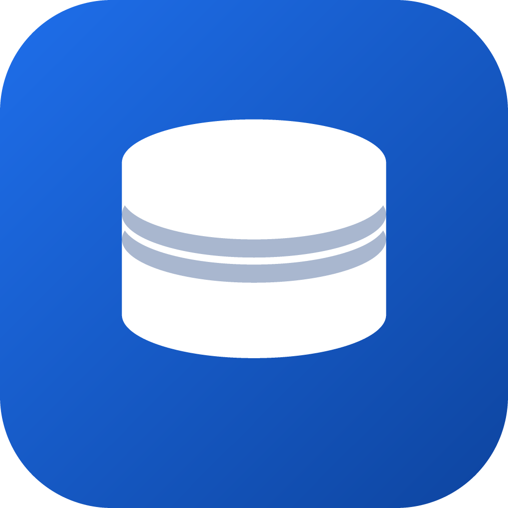

# Restaurador de BD

App de escritorio para restaurar respaldos `.sql` de **MariaDB** en **MySQL 8 / 9**,
traduciendo al vuelo la sintaxis que MySQL ya no acepta.

Eliges el archivo, el servidor y la base destino, y le das a Restaurar. Nada más.



## Por qué existe

Un dump hecho con MariaDB no carga tal cual en MySQL 8 o 9: revienta con colaciones
`utf8mb3` que ya no existen, con `CHECK (json_valid(...))`, con `DEFAULT` en columnas
TEXT y con llaves foráneas que MySQL volvió más estrictas. Normalmente terminas
arreglando el dump a mano con `sed` cada vez.

Esta app hace esa traducción sola, carga el respaldo y al final **verifica** que todo
haya quedado: compara cuántas tablas, vistas, procedimientos, funciones y disparadores
traía el respaldo contra los que realmente quedaron en la base.

## Instalación

Descarga desde [Releases](../../releases):

- **macOS** — `Restaurador de BD.dmg`: ábrelo y arrastra la app a Aplicaciones.
- **Windows** — `Restaurador de BD.exe`: cópialo donde quieras y doble clic.

No necesitas instalar Python ni MySQL: la app trae dentro todo lo necesario.

### Sobre la seguridad de macOS

La app de macOS va **firmada con un Developer ID y notarizada por Apple**, así que
se abre con doble clic como cualquier otra: sin avisos ni pasos extra.

## Cómo funciona

1. Al abrir propone el respaldo `dump-*.sql` más reciente de tu carpeta de Descargas
   y deduce la base destino leyendo la cabecera del propio archivo.
2. Comprueba la conexión y el espacio libre en disco, y pide confirmación antes de
   borrar nada.
3. Carga el respaldo mostrando avance, velocidad y tiempo restante.
4. Verifica el resultado contra el contenido del respaldo.

### Dos motores

- Si el equipo tiene el programa `mysql` instalado, lo usa: es unas 6 veces más rápido.
- Si no lo tiene, usa **PyMySQL**, incluido dentro de la app.

Ambos producen el mismo resultado; están verificados fila por fila sobre el mismo dump.

### Qué traduce

| Sintaxis de MariaDB | Qué se hace |
|---|---|
| `CHECK (json_valid(col))` | se elimina (no existe en MySQL) |
| `utf8mb3`, colaciones `utf8_*` | se convierten a `utf8mb4` |
| `date DEFAULT current_timestamp()` | se quita el default (MySQL no lo permite en DATE) |
| `DEFAULT` en columnas TEXT | se quita (MySQL lo prohíbe) |
| FK cuyo padre no tiene índice único exacto | se degrada a índice simple |
| `CREATE DATABASE` / `USE` | se omiten: la base la crea la app |
| Nombre de la base dentro de triggers y vistas | se quita, para poder restaurar con otro nombre |

Las sustituciones se aplican **solo a las líneas que no son `INSERT`**, de modo que los
datos nunca se tocan.

## Modo consola

El mismo programa funciona sin ventana:

```bash
restaurador_bd.py --cli respaldo.sql -d mi_base -y
```

| Opción | Para qué |
|---|---|
| `-d` | base destino (si se omite, la del respaldo) |
| `-H`, `-P` | servidor y puerto |
| `-u`, `-p` | usuario y contraseña |
| `-y` | no preguntar |
| `--sin-cliente` | forzar el motor incluido |

## Compilar

```bash
git clone https://github.com/a831ard0/restaurador-bd.git
cd restaurador-bd
```

- **macOS:** `./construir_mac.sh` → genera la app y el `.dmg` en `dist/`.
  Con una cuenta de Apple Developer, `./firmar_mac.sh` firma y notariza el `.dmg`
  para que se abra sin el aviso de Gatekeeper (requiere un certificado
  *Developer ID Application*; el script explica cómo prepararlo).
- **Windows:** doble clic a `construir_windows.bat` → genera `dist\Restaurador de BD.exe`.

Cada plataforma se compila en su propio sistema: PyInstaller no compila cruzado.

### Publicar una version

El repositorio compila solo con GitHub Actions. Para sacar una version nueva:

```bash
git tag v1.1.0 && git push --tags
```

Eso compila el `.dmg` en un runner de macOS y el `.exe` en uno de Windows, y los
adjunta al release. Tambien se puede lanzar a mano desde la pestana **Actions**
para comprobar que todo compila, sin publicar nada.

Para que ademas firme y notarice la app de macOS hacen falta dos cosas.

**1. Los secretos** en *Settings → Secrets and variables → Actions*:

| Secreto | Contenido |
|---|---|
| `MAC_CERT_P12_BASE64` | el `.p12` del certificado Developer ID en base64 (`base64 -i cert.p12 \| pbcopy`) |
| `MAC_CERT_PASSWORD` | la contrasena de ese `.p12` |
| `NOTARY_APPLE_ID` | el Apple ID de la cuenta de desarrollador |
| `NOTARY_TEAM_ID` | el Team ID |
| `NOTARY_PASSWORD` | una *app-specific password* de appleid.apple.com |

**2. La variable** `FIRMAR_MACOS` con valor `true`, en la pestana *Variables* de esa
misma pantalla.

Sin eso el workflow compila igual, pero la app sale sin firmar.

### Como se protegen esos secretos

- Las acciones se referencian **por SHA de commit**, no por etiqueta: una etiqueta
  puede reapuntarse a otro commit, un SHA no.
- La firma vive en un job aparte, asociado al entorno protegido **`firma-macos`**,
  que exige **aprobacion manual** antes de dar acceso a los secretos y solo se
  permite desde etiquetas `v*`. Compilar no toca ningun secreto.
- Los pull requests desde forks nunca reciben secretos (comportamiento de GitHub).

## Estructura

```
restaurador_bd.py        punto de entrada (ventana o --cli)
restaurador/nucleo.py    traducciones, avance y verificación
restaurador/motor.py     los dos motores de carga
restaurador/interfaz.py  la ventana (HTML dentro de una ventana nativa)
```

La ventana usa [pywebview](https://pywebview.flowrl.com): WebKit en macOS, WebView2 en
Windows, así que no arrastra ningún framework gráfico extra.

## Licencia

MIT — ver [LICENSE](LICENSE).
